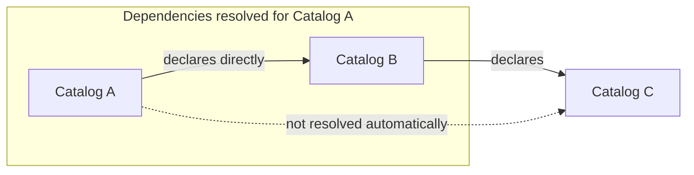

import { Steps } from "@rspress/core/theme";

# Dependencies

A catalog can import entities, schemas, and companion files from other catalogs, declared under `[dependencies]` in `catl.toml`:

```toml title="catl.toml"
[dependencies]
infra = { git = "https://github.com/acme/infra", tag = "v2.0.0" }
core  = { path = "../core" }
```

The key is the dependency's namespace and must match the `catalog.name` in its own `catl.toml`. For example, entities from `infra` are addressed as `infra.postgres`.

## Source types

Each dependency has exactly one source: `git` or `path`.

### Git repositories

Git dependencies are fetched with the system `git` binary (2.30 or later):

```toml
[dependencies]
infra    = { git = "https://github.com/acme/infra", tag = "v2.0.0" }
monorepo = { git = "https://github.com/acme/monorepo", rev = "d6e89a7123bf01c4a0b1e5f7a3c9d2e8b4f60718", subdir = "catalogs/infra" }
```

A Git source needs exactly one of `tag`, `branch`, or `rev`. `rev` must be a full 40-character hex commit hash. Annotated tags are peeled to their target commit.

`subdir` selects the catalog's subdirectory in the repository. Git submodules in the catalog's tree cause an error. Git LFS pointers aren't resolved and are read as plain text files.

### Local paths

```toml
[dependencies]
core = { path = "../core" }
```

Path dependencies are read in place. They have no commit to pin, so they're never cached or hashed and don't appear in `catl.lock`.

## The lockfile

`catl update` writes `catl.lock` at the catalog root, pinning the resolved commit and tree hash of every non-path dependency:

```toml title="catl.lock"
version = 1

[[dependency]]
requested = "git+https://github.com/acme/infra#tag=v2.0.0"
resolved = "d6e89a7123bf01c4a0b1e5f7a3c9d2e8b4f60718"
tree = "sha256:9f2c1a7b8e4f5a6b7c8d9e0f1a2b3c4d5e6f7a8b9c0d1e2f3a4b5c6d7e8f9a0b"
```

| Key         | Meaning                                                                                       |
| ----------- | --------------------------------------------------------------------------------------------- |
| `version`   | Lockfile format version                                                                       |
| `requested` | The source as declared in `catl.toml`, such as `git+https://github.com/acme/infra#tag=v2.0.0` |
| `resolved`  | The exact 40-character commit hash                                                            |
| `tree`      | SHA-256 tree hash of the fetched catalog files                                                |

Entries are sorted by `requested`. `resolved` is the exact 40-character commit hash. `tree` is the SHA-256 tree hash of the fetched files.

:::note
Only `catl update` writes the lockfile. Every other command, including `catl check`, `catl list`, and `catl.Open`, treats it as read-only. A missing entry or a mismatch with `catl.toml` fails with `ErrLockStale`.

```text
catl: catl.lock is out of date; run 'catl update'
```

:::

## Updating

`catl update` resolves dependencies to their latest matching revisions. Pass a name to update one:

```bash
catl update          # all remote dependencies
catl update infra    # one dependency
```

It fetches each remote source, compares `resolved` and `tree` against the lockfile, and writes the result.

:::warning
If a locked Git tag now points at a different commit, `catl update` aborts, because moving a published release tag is unsafe. `--force` accepts the move.

```bash
catl update --force infra
```

:::

| Source   | What `catl update` resolves                                                                                      | In `catl.lock` |
| -------- | ---------------------------------------------------------------------------------------------------------------- | -------------- |
| `tag`    | The commit the tag points at (annotated tags are peeled). A moved tag aborts the update unless `--force` is set. | Yes            |
| `branch` | The current head commit of the branch                                                                            | Yes            |
| `rev`    | The commit you specified                                                                                         | Yes            |
| `path`   | Nothing. The directory is read in place.                                                                         | No             |

## Non-transitive dependencies

`catl` resolves only the dependencies declared directly in your `catl.toml`. It doesn't recursively fetch, lock, or resolve the dependencies of those dependencies.



In this example, A depends on B, and B depends on C. When resolving A, `catl` fetches B but doesn't automatically fetch C. The dependency declared by B doesn't become a dependency of A.

If A needs to reference entities from C, it must declare C explicitly in its own `catl.toml`. This makes A's dependency set explicit and ensures that every catalog A consumes is a deliberate choice.

This behavior is by design. Unlike software package managers, which often resolve transitive dependencies to assemble the components needed to build or run an application, `catl` manages catalogs of declarative data. A catalog describes entities and their relationships; it doesn't inherently require the entire dependency tree of every referenced catalog to be fetched.

Keeping dependencies non-transitive avoids implicit dependency expansion, diamond-resolution problems, and conflicts between transitive versions. It also makes each catalog's external dependencies easier to audit and reason about.

## Vendoring

To remove network access from CI or air-gapped builds:

<Steps>

### Pin

`catl update` resolves remote dependencies and writes `catl.lock`.

### Vendor

```bash
catl vendor
```

This copies every remote dependency into `.catl/vendor/`, verified against `catl.lock`.

### Check offline

`catl check` and `catl.Open` now read remote dependencies only from `.catl/vendor/`.

</Steps>

:::important
Once `.catl/vendor/` exists, `catl` runs in strict vendor mode. There is no fallback to the global cache.
:::
